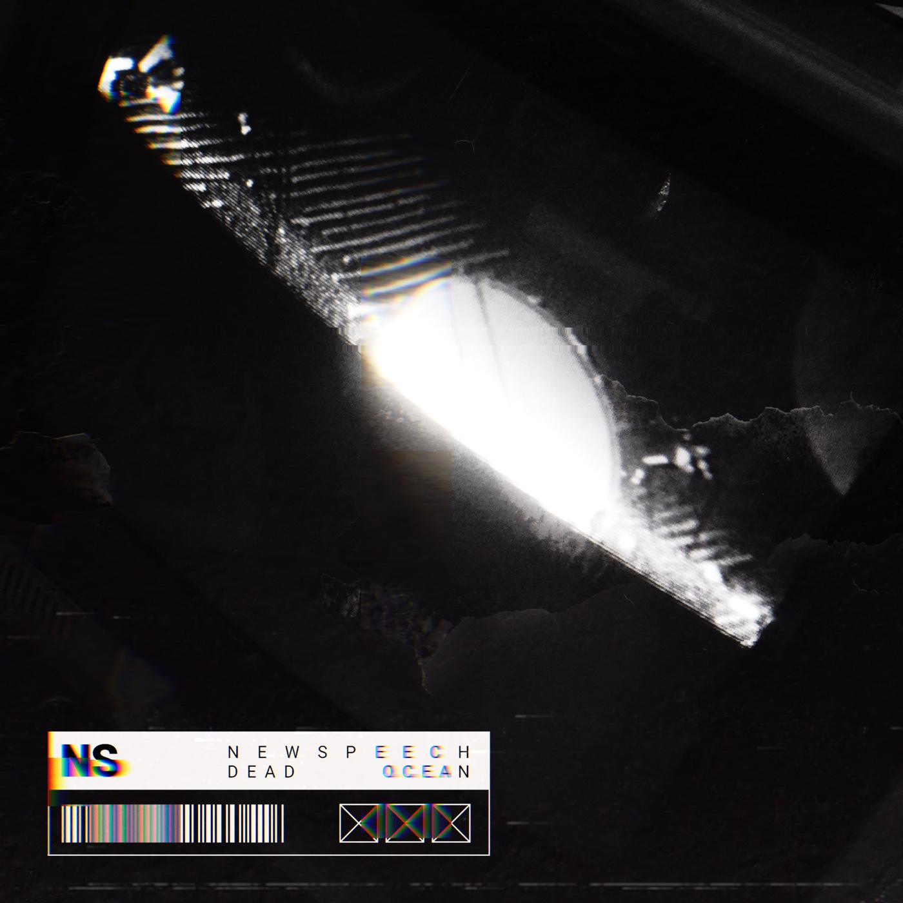

<!--
about.md — the words on about.html (built by tools/build-about.mjs, run by
build.sh). rewrite anything in your own voice; keep the `## ` headings — each
one is a section of the page, in order. the first section opens the page at
headline size (there's no separate "about" title); the frontmatter title/dek
only feed the browser tab + link previews. **bold**, *em* and [links](url) work
like the news posts.

DRAFT (2026-09-29) — assembled from your own words where they exist (the
hello-world post, the hurricane / metabolic / coverage proposals). things only
you can answer, flagged inline below with [?]:
  - chris: what else belongs in the bio — other bands/credits, the design
    work, where you're based? (left out anything not already public)
  - the record: ok to name *a hurricane in 4 centuries* publicly before it's
    announced? its proposal page is unlisted, so it isn't linked here.
  - metabolic studio / the piper maru video: left out — it's a private
    proposal. say if you want it in.
  - "it is all fucking coming apart anyway" is your line from the hurricane
    proposal — kept softened here; put it back if you want the edge.
  - anything concrete to point people at (orgs, actions, a % of something)?
    none invented.
the page is public and in the top nav (third, after news) since 10-07.
-->

## hello, world.

i'm chris elkjar. newspeech is my attempt to react to, and create within, the current apparent end times by crafting my own music tooling and trying to score this hellscape climate apocalypse that our dear world leaders are forcing us all to experience.

instrumental music often lacks a point of view or narrative. this project is noisy and often sounds like an alarm because it is.

i am a musician, designer, toolmaker, sloppy coder, occasionally mechanic. i've always been interested in the collision of technology and music - i've spent a lot more time than i'd like to admit working with my other project *the armed* across all kinds of roles, guitarist, production manager, merch guy, tour manager, noise generator etc etc. 

newspeech is all of these ideas colliding at once: make the instruments, make the music with them, and share as much of the process, ideas and concepts as possible. 

## dead ocean EP

dead ocean is a 3 song ep that is the first attempt at scoring this impending climate apocalypse. these songs are equal parts noise and melody.

[listen to the music](dead-ocean.html)

[watch the videos](video.html)
